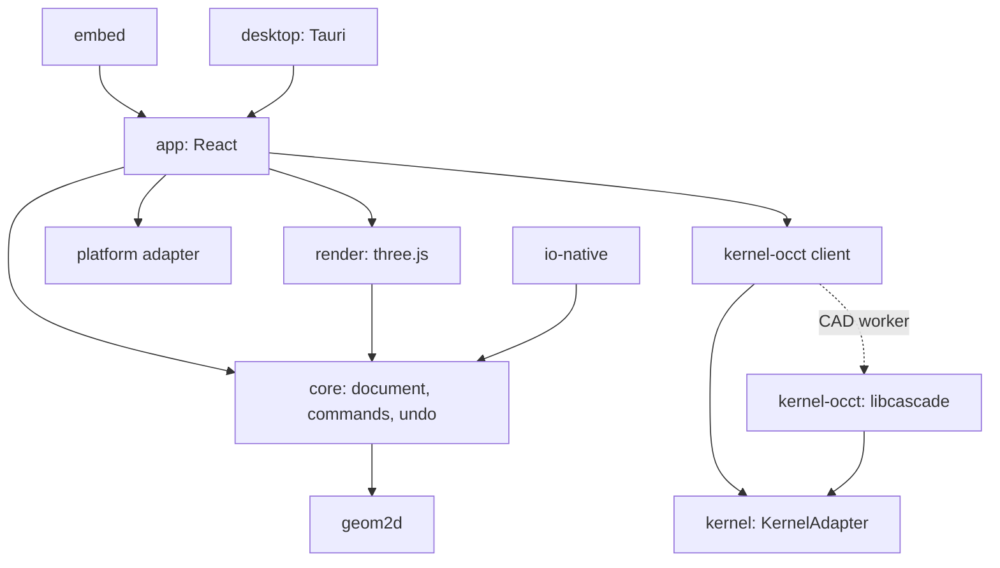

# Architecture

Allowed imports are enforced by `.dependency-cruiser.cjs`:

| Package | May import |
| --- | --- |
| core, platform | nothing internal |
| geom2d, kernel | core (types and tolerances only; ADR 0008) |
| kernel-occt | kernel, core |
| io-native | core |
| render | core, geom2d |
| app | everything except kernel-occt internals (only its `client` entry) |
| desktop | app, platform |

Key rules: the kernel lives only in the CAD worker; the UI talks to it through `KernelAdapter` via Comlink; all edits are `Command`s recorded in the `History` journal; web and desktop differ only in `PlatformAdapter`.
